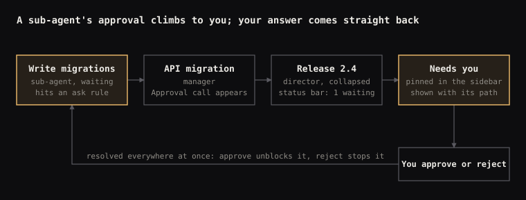

# Orchestrator UI — Design Guide

Oct 12, 2026

## Principles

Every mark on screen carries data; if a shape, colour or texture cannot say what it encodes, it is removed. The orchestrator is a dense instrument, so it earns its calm by being quiet everywhere except where something needs attention.

1. **Micrographics are functional.** A micrographic is a small compound drawing that encodes several facts at once: a ruler for which lines were read, a square ring for context used, a step track for effort. Decoration is not allowed. Before adding a shape, name the field it encodes; if there is none, cut it.
2. **One meaning per colour.** Violet is live work. Amber is "needs you". Red is failure. Model colours identify models; tool colours identify tool types. No colour is reused for a second idea.
3. **Square and cut geometry.** Corners are square. A 45° cut corner is the single exception and it is a signal: approval, the max effort level, a harness tab. The model glow is the one soft, round form, and it is reserved for identity.
4. **Dither means intensity.** Dithered fills only appear where something is happening or filling up: live rows, approvals, usage, the model glow. Density is the value. Static chrome never gets dither.
5. **Embedded, not floating.** Controls sit in ruled cells that belong to the layout (the ledger, the Send column, the header controls, panel footers). Free-floating bordered buttons are avoided.
6. **Say each thing once.** The open agent's harness, model and effort live in the ledger only; the header and the selected tree row do not repeat them.
7. **Mono by default, serif for moments.** Geist Mono carries every label and value. Instrument Serif is reserved for titles and a few named sections, so when it appears it means something.

## Foundations

The system is a dark, warm-neutral ground, two typefaces, three colour families and a handful of shapes. Everything else is built from these.

### Type

| Role | Face | Use |
| --- | --- | --- |
| Default | Geist Mono, 10–13 px | Names, labels, values, code, buttons, captions |
| Moment | Instrument Serif (and italic) | Page and session titles, model family in the ledger, "Needs you", "All agents", "Usage", "Context" |
| Numbers | Geist Mono, tabular figures | Counts, percentages, versions; versions set bold so 6.0 vs 6.1 reads at a glance |

Rule: if more than one serif element is visible in a component, one of them is wrong.

### Colour

| Family | Colours | Means | Never used for |
| --- | --- | --- | --- |
| Ground | #0D0D0F page, #161618 panels, #26262B hairlines, #EDEBE6 ink, #8F8C86 muted | Structure and text | Signals |
| Status | Violet #A5A1F2 (live), amber #E3B266 (needs you), red #E07A6E (failed) | State of an agent or call | Identity |
| Models | Sol jade #65C98C, Opus orchid #DF92D8, Sonnet azure #48BFF5, Haiku olive #B3B94F | Which model thinks | Status |
| Tools | One muted hue per tool, OKLCH L 0.80, C 0.09, hues kept clear of violet, amber and red | Which tool type was called | Status or models |

Thresholds shared by every gauge: ink while there is room, amber from 80%, red from 95%.

### Shape vocabulary

- **Status squares (10 px).** Working: solid violet, breathing. Waiting: amber with a cut corner. Failed: red with a cross. Queued: hollow. Done: a check with no box.
- **Step track.** Five squares that grow per level on a hairline; the current step wears a thin frame. Max is a diamond at the end, only for models that offer it.
- **Cut corner.** 10–14 px at 45°, drawn as an outer shape with an inner panel inset 1 px so the edge stays even. Never a clipped border.
- **Harness glyphs.** Terminal (Codex), square braces (Claude Code), paper plane (Copilot), pointer (Cursor). Square caps, mitred joins.

### Rules and cells

Hairlines (#26262B to #2E2E33) divide the layout into cells. Controls fill their cell edge to edge; a cell is divided from its neighbour by a single rule, never by a gap plus a border. Mid-grey (#56555A) is used for the stronger ledger rules; pure ink lines are not used for chrome.

### Dither

Dither is a thresholded noise over a gradient, flooded with one colour. Its density is the value: sparse means little, dense means a lot. Where it appears:

- Live rows and the session header: violet wash whose reach equals the effort level.
- Approvals: amber wash.
- Usage bars: ink, amber or red, densest at the crisp edge that marks the value.
- Model glow: the model's colour rising from the lower-left corner of the model cell.

## Agents and orchestration

Any agent can manage other agents, and none has to. Being a manager is not a type of agent, it is simply what happens when an agent uses the Spawn tool. The tree can therefore grow to any depth, and every rule below holds at every level.

### Roles are behaviour, not types

| Role | When an agent plays it | What changes in the UI |
| --- | --- | --- |
| Worker | It only uses workspace tools | A leaf row in the tree |
| Manager | It has spawned at least one sub-agent | Row gains a caret and a child count; collapsed, its model info gives way to a status bar of everything inside |
| Orchestrator / director | It manages managers and mostly waits, messages and merges results | Same row; its transcript is dominated by Spawn, Message, Wait and Result calls |

A worker that spawns a helper becomes a manager in that moment; nothing is reconfigured.

### The tree

- Each row reads left to right: expand, status, harness glyph, name, sub-agent count, model, effort steps in the model's colour.
- Indent is 14 px per level with square elbows. Past four levels a branch folds into one quiet line, "3 more levels · 6 agents", with its status bar and a Focus link.
- Focus re-roots the sidebar on any branch; a breadcrumb keeps the way back and a depth tag keeps true depth.
- Done rows soften, so live work leads the eye.

### Approvals travel up

A sub-agent never asks the person directly; it asks its parent, and the request bubbles until it reaches you.

1. The sub-agent hits a permission set to *ask* (for example "write to the database") and stops with status Waiting.
2. Its manager receives the request as an Approval call in its own transcript, showing who asked, the exact command, why, and what it blocks.
3. Every collapsed ancestor shows the wait in its status bar ("1 waiting", amber), so it is visible at any zoom.
4. The request is pinned in **Needs you** at the top of the sidebar with its path, regardless of depth.
5. Approving or rejecting anywhere (Needs you, the manager's transcript, the agent itself) resolves it everywhere and unblocks the sub-agent.

Permissions are set when an agent is spawned (allow, ask, deny per capability) and inherited downward; a child can never be given more than its parent has.



The request passes every level on the way up and can be answered at any of them; one answer resolves it everywhere.

## The conversation

The chat screen is three bands: a header that says what this session is and how it is doing, a transcript in one reading column, and a composer whose left edge is the agent's settings.

### Header

- **Title block.** Path in muted mono ("Release 2.4 /"), session name in the serif.
- **Live wash.** While the session works, a violet dither fills the whole header height down to the fingerprint strip; it reaches as far as the effort level.
- **Context gauge.** Left of the controls (see Context).
- **Control block.** Flush to the right edge, full-height cells divided by rules: *Working* with one status square per child and "4 below" (click to jump to them in the tree), *Pause* (P), *Stop* (⇧S, red square icon, red hover tint).

### Fingerprint strip

A 4 px line directly under the header splits every tool call this session has made by tool type, in each tool's colour, sized by count. Read across sessions it works as a fingerprint: a research agent is mostly Read and Search blues, a builder is Edit greens and Run, an orchestrator is Spawn, Message and Wait pinks. Hovering a segment raises it to 10 px, dims the rest, and drops a label with the tool, its count and its share; each segment is a button, so keyboard focus does the same.

### Transcript

- One column, speaker in a fixed 128 px gutter. Your messages sit on a panel; agent text sits on the page.
- Tool calls appear as collapsed rows (see Tool calls); finished groups fold into one line such as "4 actions · all done".
- Spawned sub-agents appear inline as the same rows as the tree, with an "Open in tree" link.
- Approvals from below arrive as an amber block with a cut corner: who asked, the exact command, Approve / Reject / Review diff, and what it blocks.
- The active line ("Thinking") carries the violet wash; nothing else in the transcript is dithered.

### Composer and ledger

The composer is three ruled parts: ledger, message, actions.

| Part | Contents | Behaviour |
| --- | --- | --- |
| Ledger spine | Harness glyph and name set vertically | Click to change harness |
| Ledger model cell | Model family in serif, version in bold mono, vendor caption top-right, model-colour glow from the lower-left corner | Click to change model; the glow breathes slowly |
| Ledger collapse cell | ‹ in its own cell top-right | Folds the ledger to a 66 px strip |
| Ledger effort | Cut-corner label ("effort · xhigh · 05/05") over the step track in the model's colour | Click a step to set effort |
| Message | Two-line field, "↵ send · ⇧↵ new line" | Grows with content |
| Actions column | + attach on top, Send arrow filling the rest | Send is quiet grey while empty and fills light once there is a message |

Collapsed, the ledger becomes a two-column strip: glyph, model and version over the glow on the left, the vertical step track on the right, with a white › to expand. It still shows all three settings.

### Effort and max

Steps are squares that grow with the level (minimal, low, medium, high, xhigh), filled in the model's colour; the current one wears a thin frame. Max is a sixth position drawn as a diamond and appears only for models that offer it, so the scale itself says whether the model can go further. At max the diamond fills, takes the frame, and the effort label turns the model's colour.

## Context

Context is tracked by one compound icon in the header and a breakdown panel behind it. The icon answers "how full, and how many times have we already squeezed it" without a single word.

### The gauge

| Element | Encodes |
| --- | --- |
| Square ring with a gap at the bottom | Share of the context window used; fills clockwise from the gap's left edge |
| Numeral in the centre | Percentage used |
| Squares in the gap | Compactions so far, one each; none when there have been none; past three it becomes a number ("5×") |
| Text beside it | "124k / 200k" and a status line with the compaction icon and count |
| Colour | Ink with room, amber from 80% ("compacts soon"), red from 95% ("compacting next turn") |

The gap squares never show empty placeholders, because a fixed number of slots would imply a limit that does not exist.

### Compaction

When the window fills, the agent summarises older turns to free space; the summary stays and detail is lost. Each compaction is a point where earlier detail may be gone, which is why it is counted. Its icon is a single rule with arrows pressing onto it from above and below, used on the gauge, the panel footer and the Compact now button.

### Breakdown panel

Clicking the gauge opens a panel: a larger gauge with "Context" in the serif, a bar split into system and tools, files read, conversation, sub-agent results, earlier compacted material and free space, a row per part with its size, and a ruled footer with the compaction history and an embedded **Compact now** cell. The breakdown uses greys, not tool colours, so it is never confused with the fingerprint strip.

## Usage

Usage limits are tracked at the foot of the sidebar, one row per connected harness, and each row opens into a forecast you can act on. The goal is to tell you whether to slow down or go full steam ahead before you hit a wall.

### Resting row

- Harness glyph only (name on hover and in the panel), then two stacked bars: **5h** for the rolling session window and **wk** for the weekly limit, each with its percentage.
- The fill is dithered and densest at its crisp end, which marks usage.
- A thin grey tick marks how much of that window has passed. A fill that runs past its tick is burning faster than the clock, readable without numbers.
- Same thresholds as the context gauge: ink, amber from 80%, red from 95%.

### Opened row

| Block | What it shows |
| --- | --- |
| Session · 5h | Time to reset; a forecast bar where a dashed line runs from current usage to the projected value at reset, ending in a hollow square (lands under 100%) or a red arrow (overruns); verdict with the burn rate (%/h) and the detail on its own line |
| Week | The same in %/day, with the reset day and time |
| Model mix this week | A thin bar in the model colours with each share |
| Heaviest agents this week | The sessions that consumed most of the limit |
| Quick stats | Peak hour, average session, safe pace to finish the week, cache hit rate |
| Suggestion | A ruled footer with one concrete move ("Flaky tests → Sonnet lands the session") and an embedded Apply cell |

Every line is single-line and trims with an ellipsis rather than wrapping.

### Forecast

The projection assumes the pace so far continues until the window resets. With usage p (%), time elapsed e and time left l in the same unit:

```latex
\text{rate} = \frac{p}{e} \qquad \text{projected} = p + \text{rate} \cdot l \qquad \text{empty in} = \frac{100 - p}{\text{rate}}
```

| Verdict | Condition | Colour | Detail line |
| --- | --- | --- | --- |
| Runs out early | projected > 100% | Red | "empty in 1h 14m · 1h 46m before reset" |
| On pace | 75% < projected ≤ 100% | Ink | "\~16% spare at reset" |
| Full steam ahead | projected ≤ 75% | Green | "\~40% would go unused" |

Worked example: Claude Code at 62% after 2 h of a 5 h session burns 31%/h, projects to 155% at reset and empties in 1 h 14 m, 1 h 46 m before reset.

## Tool calls

Every tool call is one row that already tells you what happened and how it went; opening it only adds detail. Thirteen tools share one anatomy and three openings.

### Anatomy of the collapsed row

Left to right: status square · tool icon (tool colour) · verb (tool colour) · target · the tool's own micrographic · three opening squares. The row border is a faint tint of the tool colour. Special calls (working, waiting) keep their dither wash and status border instead, and only the icon and verb take the tool colour.

### Three openings

The three small squares at the right edge show and set how open a call is.

1. **Collapsed** (one filled): the single row.
2. **Summary** (two filled): the key facts in a few lines, such as the changed hunks or the last lines of output.
3. **Expanded** (three filled): everything, such as the full diff, the full output, the permissions list.

### Workspace tools

| Tool | Collapsed micrographic | Summary | Expanded |
| --- | --- | --- | --- |
| Read | Ruler showing which slice of the file was read (L1–120) | Range and what was found | Code with line numbers; lines read vs not read |
| Edit | +12 −3 with five squares: filled = added, red outline = removed | One line per hunk | Diff, removals struck through |
| Create | Cut-corner file icon, "new · 38 lines" | First line | File content |
| Search | One column per file, height = hits | Bar per file | Matching lines grouped by file |
| Run | Exit-code chip (red when not 0) and duration | Last lines of output | Full output |
| Test | One square per test, grey passed, red failed | Failing test names | Large grid and failure trace |
| Fetch | Response-status chip | Title and how it was used | What was read and kept |
| Plan | n/m squares; violet wash while active | The to-do list | Each step with the sub-agent that owns it |

### Orchestration tools

| Tool | Collapsed micrographic | Expanded |
| --- | --- | --- |
| Spawn | Child's harness glyph, model and effort steps in the model colour | Task, context, who it reports to, permissions (allow / ask / deny) |
| Message | Target agent and "read" once delivered | The exchange between the two agents |
| Wait for | One status square per awaited agent; violet wash | A time lane per agent: hollow queued, violet working, amber waiting, grey done |
| Approval | Amber, cut corner, "pending" chip | Command, why, what it touches, what it blocks; Approve once / Always for this path / Reject |
| Result | What came back ("6 tables · 1 file") | The result, attachments, and where it is used |

### Tool colours

Workspace tools run from olive (Plan) through greens and teals to blue (Run). Spawn is pale blue; Message, Wait and Result are a family of mauves and pinks; Approval keeps amber because asking you is what it does. The same colours draw the fingerprint strip.

## Building a new component

Run every new piece through these questions in order; a component that fails one is not finished.

1. **What fields does it encode?** List them. Each shape, colour and texture maps to one field.
2. **Is it already shown?** If the value lives elsewhere on screen, link to it instead of repeating it.
3. **Which colour family?** Status, model or tool; never borrow across families.
4. **Does anything happen here?** Only then may it be dithered, and the density must mean something.
5. **Is it embedded?** Controls sit in ruled cells that belong to their container.
6. **Does it fold?** Give it a resting state that still carries every field, and an opened state with the detail.
7. **Does it fit without wrapping?** Single lines trim with an ellipsis; numbers use tabular figures.
8. **Can it be read without colour?** Shape and position carry the value; colour confirms it.

| Do | Don't |
| --- | --- |
| Count with filled marks only (compaction squares) | Draw empty slots that imply a limit |
| Let a scale reveal capability (max diamond appears only when offered) | Show disabled options for things a model cannot do |
| Put identity in a corner glow or tick | Crowd an extra swatch into a line of text |
| Use one fix per problem | Stack two tricks (a cell and a recolour) to solve one issue |
| Keep the serif for titles and named sections | Set body text or labels in the serif |
